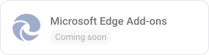

<p align="center"></p>

<h1 align="center">AppliCliq</h1>

<p align="center">A free, open-source job application tracker that lives in your browser.</p>

<p align="center"><sub>Formerly Career Pocket. Your saved jobs and sync carry over as they are.</sub></p>

<p align="center">
  
</p>

## Get it

<p align="center">
  <a href="https://addons.mozilla.org/en-US/firefox/addon/career-pocket/"><picture><source media="(prefers-color-scheme: dark)" srcset="docs/readme/firefox-dark.svg" /></picture></a>
  <a href="https://addons.mozilla.org/en-US/firefox/addon/career-pocket/"><picture><source media="(prefers-color-scheme: dark)" srcset="docs/readme/firefox-android-dark.svg" /></picture></a>
  <picture><source media="(prefers-color-scheme: dark)" srcset="docs/readme/chrome-dark.svg" /></picture>
  <br />
  <picture><source media="(prefers-color-scheme: dark)" srcset="docs/readme/edge-dark.svg" /></picture>
  <picture><source media="(prefers-color-scheme: dark)" srcset="docs/readme/opera-dark.svg" /></picture>
  <picture><source media="(prefers-color-scheme: dark)" srcset="docs/readme/safari-dark.svg" /></picture>
</p>

<p align="center">
  <a href="https://applicliq.pages.dev/install"><picture><source media="(prefers-color-scheme: dark)" srcset="docs/readme/install-manually-dark.svg" /></picture></a>
  <a href="https://applicliq.pages.dev"><picture><source media="(prefers-color-scheme: dark)" srcset="docs/readme/web-dashboard-dark.svg" /></picture></a>
</p>

## Features

- Save a job from any posting in one click (or Alt+Shift+S); title, company, location and salary
  fill themselves in.
- Track each application from saved to offer in a list, a kanban board, or stats with weekly goals.
- Follow-up and interview reminders; quiet applications are marked ghosted after three weeks.
- A badge on job pages you already saved, and a note when you've applied to a company before.
- Smart helpers: a "Heads up" note on old or closed postings, missing salaries and companies you
  applied to recently; the same job saved from two sites spotted and merged; follow-up messages
  from templates and a "Needs follow-up" list; offer details compared side by side, with a
  reminder before each deadline.
- Insights: response, interview and offer rates and reply times by source and work type, a weekly
  recap notification, and a share card of your numbers (never company names) as a PNG.
- Import your history: LinkedIn applications (from LinkedIn's data export) or any CSV from a
  spreadsheet, Notion, Huntr or Teal, with column matching, duplicate checks and undo.
- Optional features can be turned on and off in Settings → Features; any extra browser
  permission is asked for only when you turn a feature on.
- Works offline. Export to JSON or CSV any time.

## Privacy

- Your jobs are stored in your browser. There is no AppliCliq server or account.
- Sync is optional: it uses a hidden app folder in your own Google Drive, which AppliCliq can't
  see outside of.
- No analytics, no tracking, no ads. See the [privacy policy](https://applicliq.pages.dev/privacy).

## How to use

1. Install the extension and pin it to the toolbar.
2. Open a job posting and click the AppliCliq icon. Check the details and save.
3. Open the dashboard to update statuses, add notes and set reminders.
4. Optional: turn on Google Drive sync in Settings to see your jobs in other browsers and on
   [the website](https://applicliq.pages.dev/app).

## Development

Requires Node 22+ and pnpm 10.

```bash
git clone https://github.com/salman-sayeed/applicliq.git
cd applicliq
pnpm install
pnpm dev:ext   # extension with hot reload (opens Chrome)
pnpm dev:web   # website and web dashboard on http://localhost:5173
```

| Command          | What it does                                     |
| ---------------- | ------------------------------------------------ |
| `pnpm build`     | Build the extension (Chrome) and the website     |
| `pnpm build:ext` | Build the extension for Chrome, Edge and Firefox |
| `pnpm test`      | Unit tests (Vitest)                              |
| `pnpm typecheck` | `tsc -b` + `svelte-check`                        |
| `pnpm lint`      | ESLint                                           |
| `pnpm format`    | Prettier                                         |

```
apps/extension    browser extension (WXT, Svelte 5, Tailwind)
apps/web          website and web dashboard (SvelteKit, static, Cloudflare Pages)
packages/core     data model, storage, merge, Drive sync, job-page scrapers
packages/ui       shared Svelte components and theme
```

Drive sync needs your own OAuth client IDs: see [docs/google-setup.md](docs/google-setup.md).
Store links and their status live in [`apps/web/src/lib/config.ts`](apps/web/src/lib/config.ts);
update the "Get it" row above when a store goes live. [CLAUDE.md](CLAUDE.md) covers the data
model, sync design and project rules.

## Contributing

Issues and pull requests are welcome. See [CONTRIBUTING.md](CONTRIBUTING.md).

## License

[MIT](LICENSE)

## Support

AppliCliq is free. If it helped you, you can buy me a coffee ☕

- Buy me a coffee: _link coming soon_
- Crypto: _wallet address coming soon_

<!-- Keep these in step with SUPPORT in apps/web/src/lib/config.ts, which the website's Support section reads. -->
